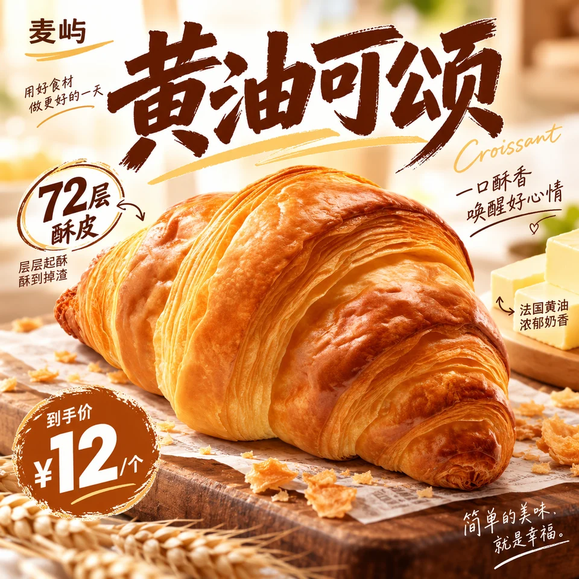
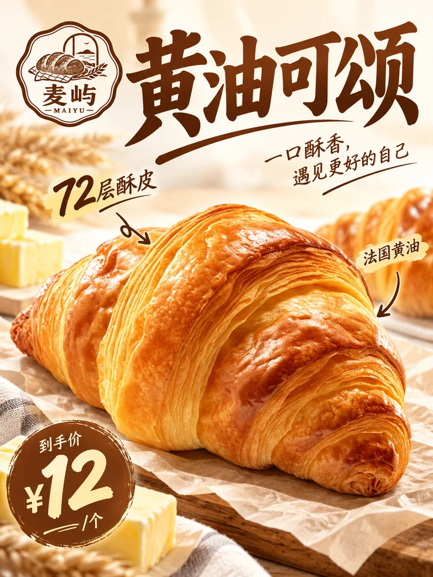
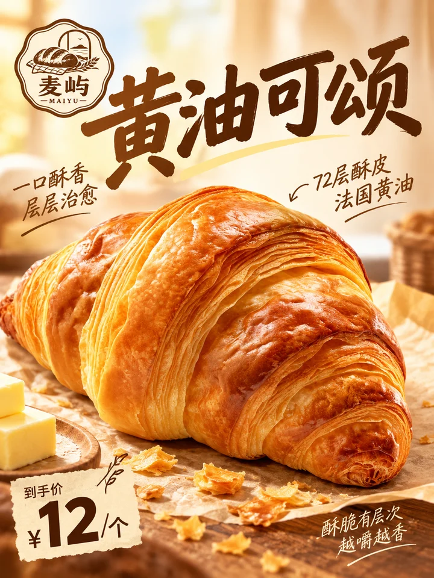
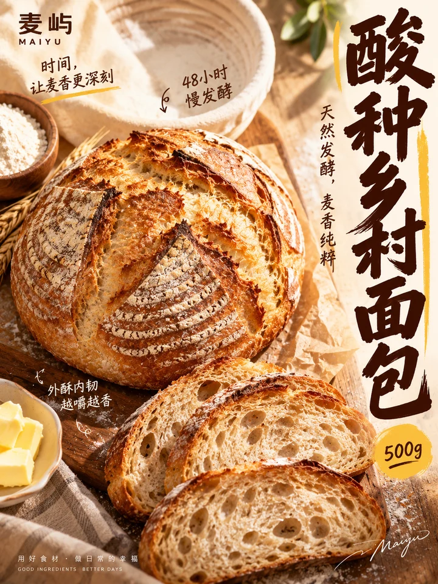
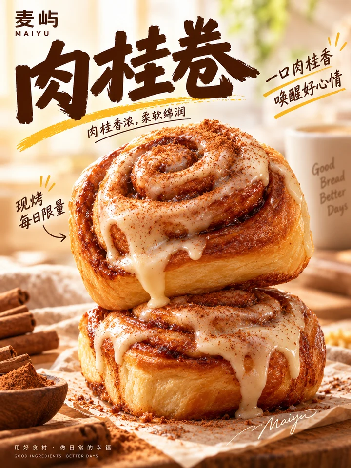
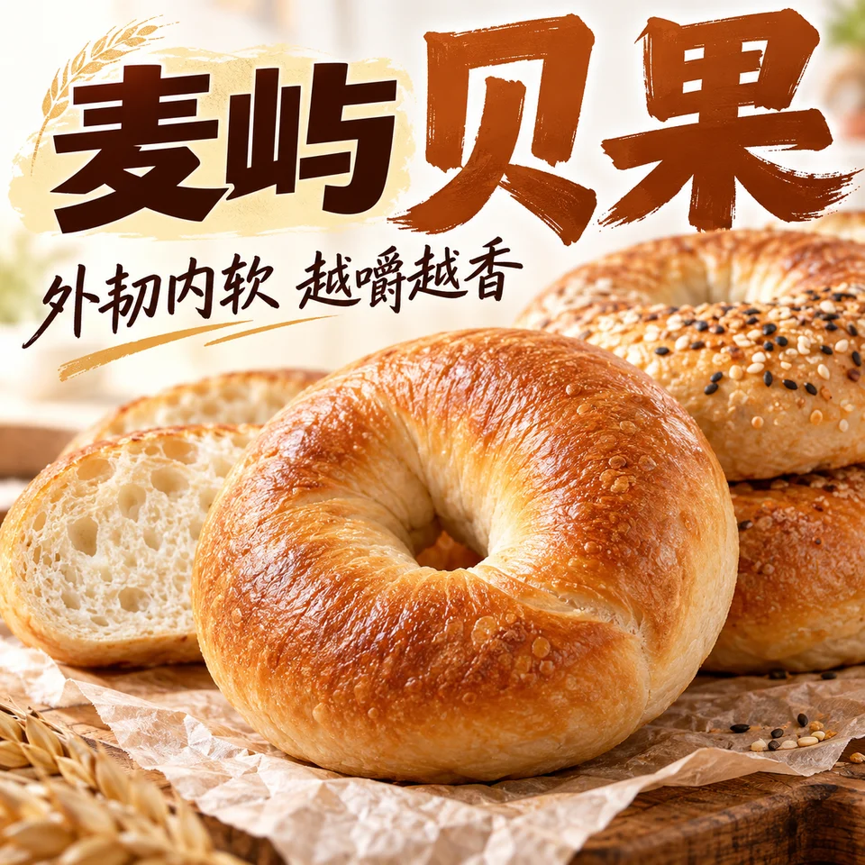
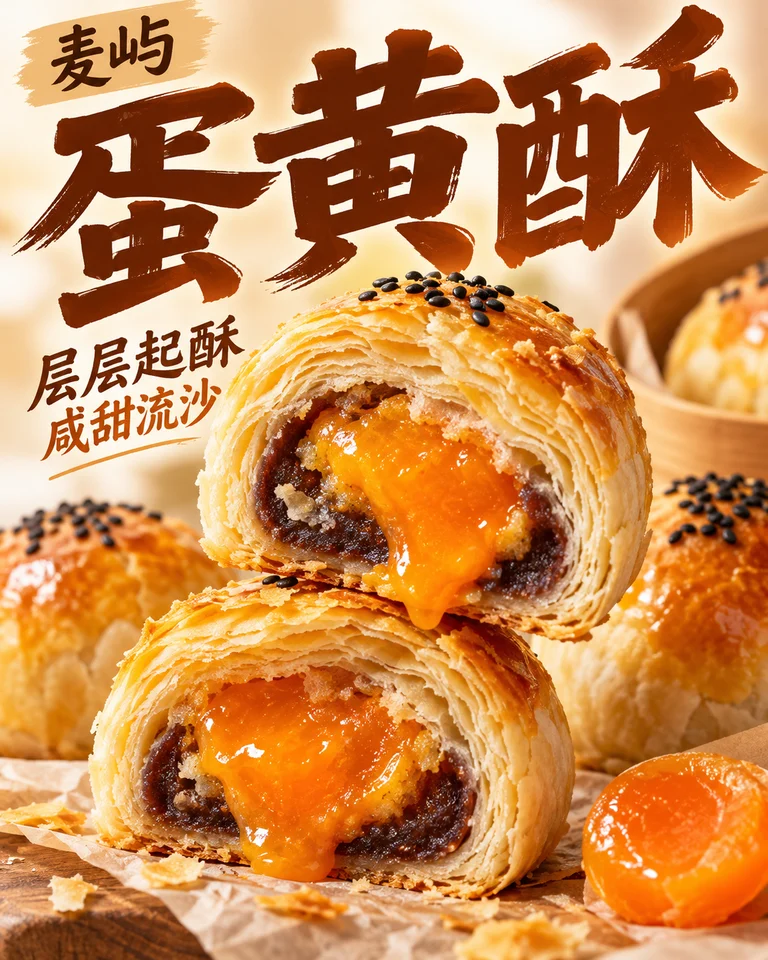
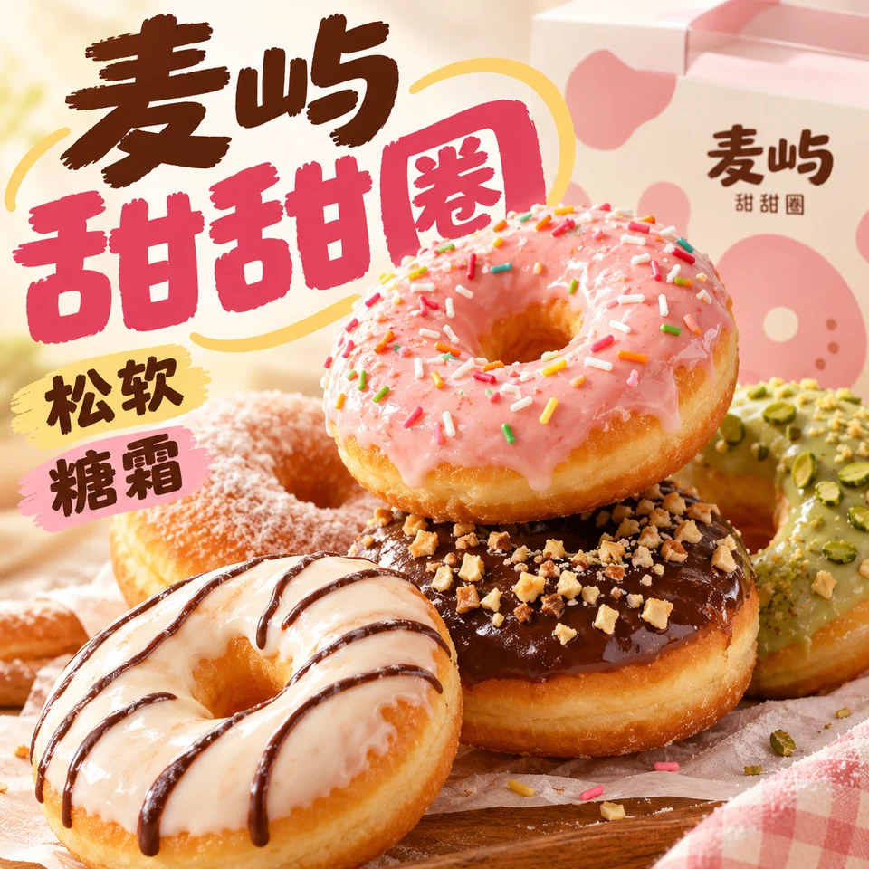
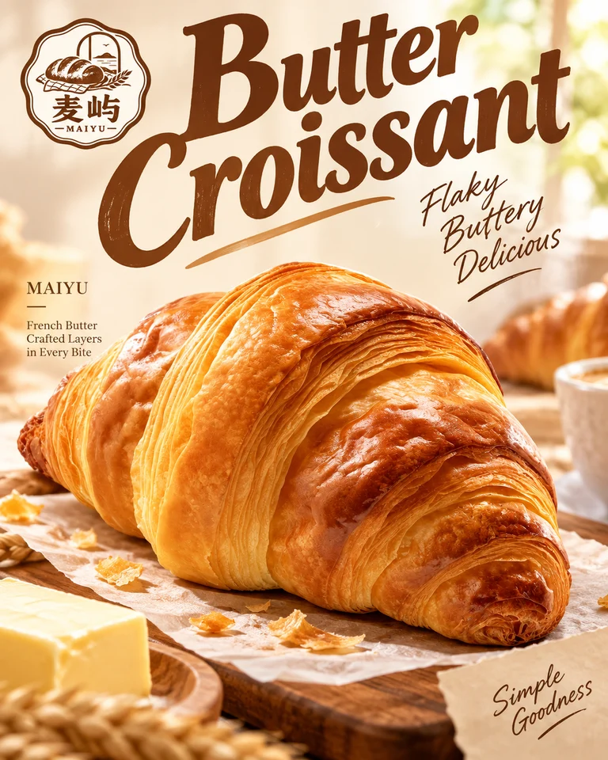

<div align="center">

# 🦁 XXD Shop 004｜烘焙系列海报

### 够大、够近、够好吃，一套上新一个品牌世界

<strong>简体中文</strong> · <a href="README.en.md">English</a>

</div>

**给烘焙店做单张或一整套上新海报：够大、够近、够好吃，一套图是同一家店。**
做系列时先出一张定调海报给你确认，之后每款共享字体、色彩和店名识别，构图各不相同。

| 一眼看懂 | |
|---|---|
| **交给它** | 产品图或产品名（可多款）；店名或品牌字标；价格等想写上去的信息 |
| **你拿到** | 烘焙单品海报，或一套风格统一、构图各异的上新系列 |
| **风格特点** | 超大近景产品 · 暖亮晨光 · 产品名就是品牌图形 · 杂志式手写标注 · 系列每张构图不同 |
| **最适合** | 面包、蛋糕、可颂、挞派、饼干、月饼等烘焙上新和节日系列 |

> **装好后，直接这样说：**
>
> /xxd-shop-004 开心果流心可颂，做一张 3:4 的单品海报

<!-- xxd-samples:start -->
## 样张

<p align="center"><a href="assets/examples/s01-size-1x1-1254x1254.png"></a><br><sub>上新主图 · 1:1 · 1254x1254<br>麦屿 黄油可颂 · <a href="assets/examples/sources/croissant.jpg">原图</a> + <a href="assets/examples/sources/logo-maiyu.png">Logo</a> · 模型写字（中文）</sub></p>

### 一个商品，适配每个位置

同一商品、同一套风格，每个比例都重新构图，不是裁切。

<table>
<tr><td align="center" valign="top"><a href="assets/examples/s01-size-1x1-1254x1254.png"></a><br><sub>上新主图 · 1:1 · 1254x1254<br>麦屿 黄油可颂 · <a href="assets/examples/sources/croissant.jpg">原图</a> + <a href="assets/examples/sources/logo-maiyu.png">Logo</a> · 模型写字（中文）</sub></td><td align="center" valign="top"><a href="assets/examples/s02-size-3x4-1086x1448.png"></a><br><sub>上新海报 · 3:4 · 1086x1448<br>麦屿 黄油可颂 · <a href="assets/examples/sources/croissant.jpg">原图</a> + <a href="assets/examples/sources/logo-maiyu.png">Logo</a> · 模型写字（中文）</sub></td><td align="center" valign="top"><a href="assets/examples/s03-size-9x16-941x1672.png"></a><br><sub>门店竖屏 · 9:16 · 941x1672<br>麦屿 黄油可颂 · <a href="assets/examples/sources/croissant.jpg">原图</a> + <a href="assets/examples/sources/logo-maiyu.png">Logo</a> · 模型写字（中文）</sub></td><td align="center" valign="top"><a href="assets/examples/s04-size-16x9-1672x941.png"></a><br><sub>横幅 · 16:9 · 1672x941<br>麦屿 黄油可颂 · <a href="assets/examples/sources/croissant.jpg">原图</a> + <a href="assets/examples/sources/logo-maiyu.png">Logo</a> · 模型写字（中文）</sub></td></tr>
</table>

### 烘焙系列（套图）

<table>
<tr><td align="center" valign="top"><a href="assets/examples/p01-set-3x4-1086x1448.png"></a><br><sub>系列上新海报 · 3:4 · 1086x1448<br>麦屿 黄油可颂 · <a href="assets/examples/sources/croissant.jpg">原图</a> + <a href="assets/examples/sources/logo-maiyu.png">Logo</a> · 模型写字（中文）<br>第 1 / 3 张</sub></td><td align="center" valign="top"><a href="assets/examples/p02-set-3x4-1086x1448.png"></a><br><sub>系列上新海报 · 3:4 · 1086x1448<br>麦屿 酸种乡村面包 · <a href="assets/examples/sources/logo-maiyu.png">Logo</a> · 模型写字（中文）<br>第 2 / 3 张</sub></td><td align="center" valign="top"><a href="assets/examples/p03-set-3x4-1086x1448.png"></a><br><sub>系列上新海报 · 3:4 · 1086x1448<br>麦屿 肉桂卷 · <a href="assets/examples/sources/logo-maiyu.png">Logo</a> · 模型写字（中文）<br>第 3 / 3 张</sub></td></tr>
</table>

### 换一个品类也成立

<table>
<tr><td align="center" valign="top"><a href="assets/examples/c01-category-3x4-1086x1448.png"></a><br><sub>上新海报 · 3:4 · 1086x1448<br>麦屿 草莓奶油蛋糕 · <a href="assets/examples/sources/logo-maiyu.png">Logo</a> · 文案方案（中文）</sub></td><td align="center" valign="top"><a href="assets/examples/c02-category-1x1-1254x1254.png"></a><br><sub>上新主图 · 1:1 · 1254x1254<br>麦屿 贝果 · <a href="assets/examples/sources/logo-maiyu.png">Logo</a> · 文案方案（中文）</sub></td><td align="center" valign="top"><a href="assets/examples/c03-category-4x5-1122x1402.png"></a><br><sub>社媒 · 4:5 · 1122x1402<br>麦屿 蛋黄酥 · <a href="assets/examples/sources/logo-maiyu.png">Logo</a> · 文案方案（中文）</sub></td></tr>
<tr><td align="center" valign="top"><a href="assets/examples/c04-category-9x16-941x1672.png"></a><br><sub>门店竖屏 · 9:16 · 941x1672<br>麦屿 巴斯克芝士蛋糕 · <a href="assets/examples/sources/logo-maiyu.png">Logo</a> · 文案方案（中文）</sub></td><td align="center" valign="top"><a href="assets/examples/c05-category-1x1-1254x1254.png"></a><br><sub>上新主图 · 1:1 · 1254x1254<br>麦屿 甜甜圈 · <a href="assets/examples/sources/logo-maiyu.png">Logo</a> · 文案方案（中文）</sub></td><td align="center" valign="top"><a href="assets/examples/c06-category-16x9-1672x941.png"></a><br><sub>横幅 · 16:9 · 1672x941<br>麦屿 黄油曲奇礼盒 · <a href="assets/examples/sources/product-maiyu-cookies.jpg">商品图</a> + <a href="assets/examples/sources/logo-maiyu.png">Logo</a> · 文案方案（中文）</sub></td></tr>
</table>

### 换语言

<table>
<tr><td align="center" valign="top"><a href="assets/examples/s08-special-4x5-1122x1402.png"></a><br><sub>上新海报 · 4:5 · 1122x1402<br>麦屿 黄油可颂 · <a href="assets/examples/sources/croissant.jpg">原图</a> + <a href="assets/examples/sources/logo-maiyu.png">Logo</a> · 模型写字（英文）</sub></td></tr>
</table>

<sub>样张商品均为虚构的演示品牌，价格、规格等数字为演示设定；演示商品图与 Logo 由本项目生成，部分以 Unsplash 照片为底，署名与许可见 [assets/examples/README.md](assets/examples/README.md)。每张都是单次生成的完整画面，未修图、未拼接、未放大，像素照实标注；没通过目视验收的已重出，不放进来。点开看原尺寸。</sub>

<!-- xxd-samples:end -->

## 它解决什么

烘焙店上新，最常见的两种失败：一种是每张图都好看，放在一起却像四家店；另一种是一套图统一了，结果每张都是同一个模板换个面包。

**Shop 004** 的办法是：**不同海报可以换构图，但字体气质、色彩情绪和品牌识别要共享。**

单张也一样能做：产品够大够近，酥皮、气孔、拉丝、流心、糖霜这些最馋的质感被放大，光线像清晨的烘焙橱窗。

## 一套系列是怎么做出来的

1. 你给一组产品：多张图、一个文件夹，或几个产品名。
2. 它先写一份分镜：每款一张，每张分一种版式（巨字做背景、竖向堆叠、单个超大产品、多件错落、原料从边缘进入……），相邻两张不重复。每款的口味、价格和贴纸只属于它自己。
3. 分镜和第 1 款的定调海报一起给你看，你确认字体、颜色和店名的感觉。
4. 其余每款各出一张，继承定调图的字体气质、色彩情绪和品牌识别。

只有一款产品也能做一套：每张突出一种它真有的质感，比如酥皮层次、拉丝或流心。不满意定调图，就只重做定调图，后面的不会跟着错。

## 你需要准备

- **产品图或产品名**（必需）：有图时切面和馅料以图为准，不会加料。
- **店名或品牌字标**（做系列时强烈推荐）：它是整套图的识别。
- **价格、“每日现做”、获奖、开店年份**（可选）：说了才会出现。

## 怎么用

### 第一步：安装（只需一次）

```bash
git clone https://github.com/nevertoday/xxd-shop-004.git
mkdir -p ~/.claude/skills
ln -s "$(pwd)/xxd-shop-004" ~/.claude/skills/xxd-shop-004
```

Codex 用户把同一个文件夹链接到 `~/.codex/skills/xxd-shop-004`。装好后重开一次 AI 助手的会话。

### 第二步：用大白话说出你要什么

```text
/xxd-shop-004 开心果流心可颂，做一张 3:4 的单品海报
/xxd-shop-004 ~/Desktop/秋季上新 里四款新品做成一套，店名叫麦野烘焙
/xxd-shop-004 只有一款伯爵红茶戚风，做一套 3 张，每张突出一种口感
```

不用记参数。没说清的事（比如尺寸、张数），它会一次问齐；第二次用时可以直接沿用上次的设置。

### 第三步：它会这样做

1. 看你的商品图和描述，只问还没定的事；尺寸会按用途推荐比例，并告诉你像素。
2. 做一套时，先给你看分镜和第 1 张定调海报，你确认后再出其余几张。
3. 每个尺寸都重新构图，不是从一张图裁出来的。
4. 交付前逐张检查：商品有没有被改、字有没有写错、有没有多出你没给的数字。不通过的会告诉你并重做。
5. PNG 存进 `~/Desktop/xxd/xxd-shop-004/` 下新建的任务文件夹，把路径告诉你。

<details>
<summary><strong>进阶：命令参数写法（熟练后再看）</strong></summary>

```text
# 一张：可颂单品海报
/xxd-shop-004 ./开心果可颂.jpg --product "开心果流心可颂" --size 3:4 --text prompt --locale zh-CN

# 一套：目录里四款新品，先定调再出其余三张
/xxd-shop-004 ~/Desktop/秋季上新/ --product "麦野烘焙 · 秋季上新" --size 3:4 --text prompt --locale zh-CN

# 只有产品名的系列
/xxd-shop-004 --product "巴斯克芝士蛋糕；伯爵红茶戚风；海盐焦糖布朗尼" --size 4:5 --text prompt --locale zh-CN
```

常用参数：`--product` · `--size` · `--text prompt / exact / plan / none` · `--facts` · `--locale`。完整参数见[运行说明](references/shop-runtime.md)。

</details>

## 常见问题

**不是烘焙的商品能用吗？**

这款专为烘焙设计。其他品类建议用 [001](https://github.com/nevertoday/xxd-shop-001) 或 [009](https://github.com/nevertoday/xxd-shop-009)。

**需要什么才能用？**

三样东西：① 一个支持 Skills 的 AI 助手，比如 Claude Code 或 Codex；② 一个能出图的模型，可以是助手自带的出图能力，也可以是在 Codex 里配置好的、通过 Responses 接口出图的模型供应商（默认用 GPT Image 2）；③ 电脑上装有 Python 3.11 以上和 Pillow（`pip install pillow`）。

**要花钱吗？能商用吗？**

Skill 本身免费下载，出图费用由你自己的模型账户承担。本项目采用 PolyForm 非商业许可：个人学习、研究、测试可以直接用；用于店铺经营、接单交付等商业用途，需要先取得作者的书面授权，见文末“许可证”。

**出来的图有多大？**

你可以指定比例或准确像素。实际像素以模型返回为准，不会偷偷放大冒充高清，文件名里写的就是真实像素。

**图里的字会写错吗？**

AI 出图偶尔会写错字，或在品牌名旁多出 ® 这类小符号。交付前会逐张放大检查，发现问题就重做那一张；本页的样张都过了这一步。

**会不会乱写价格、销量？**

不会。画面上像事实的内容（价格、规格、产地、销量、获奖、认证……）只来自你提供的信息或商品图上看得清的字；没给就不写，也不放“¥XX”这种占位。

**能一次处理很多商品吗？**

能。把商品图文件夹交给它，每张图当作一件商品，尺寸和文字设置只问一次；每件商品的信息和文案互不串用。

## 它的原则

- **风格不走样：** 这款背后是一份成熟的商业设计提示词（[设计原文](references/original-prompt/zh-CN.md) · [English](references/original-prompt/en.md)）。Skill 不改写它，也不另加配色和美术指导，只把你的商品、尺寸、文字和事实交给模型。
- **商品不改款：** 有商品图时，造型、颜色、包装文字和 Logo 以图为准。
- **只用你给的事实，** 每件商品各管各的，不借用别的商品、旧成品或样张里的内容。
- **交付真实的 PNG 位图，** 不用 SVG 或代码绘图冒充；每次调用都新建任务文件夹。
- 系列只共享字体气质、色彩情绪和品牌识别三样；构图、产品和文案不会从上一张复制。

<!-- xxd-shop-tail -->
<details>
<summary><strong>项目结构（给开发者）</strong></summary>

```text
xxd-shop-004/
├── SKILL.md
├── README.md / README.en.md
├── LICENSE
├── agents/openai.yaml
├── assets/examples/
├── scripts/
│   ├── configured_imagegen.py
│   └── shop_preferences.py
└── references/
    ├── shop-runtime.md
    ├── runtime-preferences.md
    ├── sample-workflow.md
    └── original-prompt/
        ├── README.md
        ├── zh-CN.md
        └── en.md
```

</details>

<!-- xxd-readme-ads:start -->
## 关于 XXD

XXD 是小小东品牌名的缩写，本项目由小小东创建并维护：[@xiaoxiaodong01](https://x.com/xiaoxiaodong01)。

## 小小东多端会员 · 699 元/年

> **广告与商业信息声明：** 以下二维码、会员与付费服务链接属于小小东的广告信息。是否扫码或购买完全自愿，不影响本开源项目的访问与使用。

一次年费，同时开通三项会员权益：**知识星球 + 小小东成员提示词库 + 全部 将军总指挥 Skills 会员**。三项权益合并在同一份会员中，无需分别购买。

<!-- xxd-shop-command-system:start -->

### Skills 如何协作

| 层级 | 包含内容 | 用途 |
|---|---|---|
| **General** | `xxd-shop-all` | 识别可用的编号 Skills，按商品、用途和画面需求推荐，并组织多风格试稿与批量任务。 |
| **Soldier** | `xxd-shop-NNN` | 每个编号执行自己的原始提示词与审美，完成 General 分派的具体任务。 |

<!-- xxd-shop-command-system:end -->

### 会员权益

1. **微信一对一 AI 学习与项目答疑**
   扫描下方二维码，添加小小东微信，围绕 AI 学习、工具使用和实际项目进行一对一沟通，获得答疑与建议；代表性问题将整理为会员内容。
2. **持续更新的成员提示词库**
   [小小东成员提示词库](https://vip.xiaoxiaodong.ai/)当前约有 3.2 万条提示词，会持续整理和扩充，目标超过 10 万条。
3. **全部 将军总指挥 Skills 与使用答疑**
   一份会员覆盖全部 将军总指挥 Skills；使用过程中遇到问题，可以获得相应的使用说明与答疑。
4. **高频刚需优先处理**
   会员提出的高频、刚需提示词与 Skills 需求，会优先评估和开发。

### 如何开通

- 可在[成员网站](https://vip.xiaoxiaodong.ai/)自助开通。
- 也可以扫描下方二维码，添加小小东微信，进行一对一沟通并获得开通协助。

<p align="center"><a href="https://xiaoxiaodong.pages.dev/assets/wechat-qr.png"></a></p>
<!-- xxd-readme-ads:end -->

## 许可证

本项目（包括 Skill、提示词、脚本、文档及随附样张）采用 **PolyForm Noncommercial License 1.0.0**。完整法律条文请见 [LICENSE](LICENSE)，官方页面见 <https://polyformproject.org/licenses/noncommercial/1.0.0>。

用人话说：

- 个人可以用于学习、研究、实验、测试、兴趣项目和私人娱乐；慈善机构、教育机构、公共研究/安全/卫生机构、环保组织及政府机构也可以使用。
- 在**非商业目的**下，你可以使用、复制、修改、制作衍生作品并分享；分享时必须同时提供本许可证（或上面的链接）以及作者提供的所有 `Required Notice:` 声明。
- 不允许用于商业产品或服务、收费交付、出售访问权或许可，或任何预期会带来商业应用的用途。需要商业使用时，请先向版权方另行取得书面许可。
- 本协议只授予其中明确写出的著作权许可和有限的专利许可，不授予商标、品牌名称或其他未明确授予的权利，也不能把你的许可再转授给他人。
- 如果收到书面违约通知，须在 32 天内纠正并采取实际补救措施，否则许可会立即终止；就专利侵权提出书面主张也会终止专利许可。
- 内容按“现状”提供，在法律允许的范围内不作任何担保，使用风险和可能的损失由使用者自行承担。
